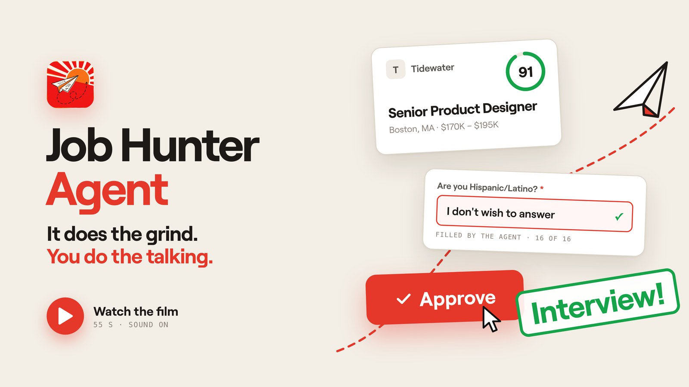

<p align="center"></p>

# Job Hunter Agent

A personal agent that turns your own material into job applications: it finds postings, ranks them, writes a
one-page résumé from facts you approved, fills the form or drafts the email, and waits for you to say yes.

<a href="https://siennachen.com/project-job-hunting-agent.html"></a>

▶ **[Watch the 55-second film](https://siennachen.com/project-job-hunting-agent.html)** (sound on) · or the [mp4 in this repo](docs/media/job-hunter-agent-film.mp4). It shows demo data: a fictional applicant and fictional companies, and the application form is filled by the agent's own code.

**New here? Start with the [User guide](USER_GUIDE.md).**


## Not autopilot

The agent runs on your judgement. Your storybook decides what can be said, your taste decides what goes out, and every
application stops in the dashboard, where you approve it, edit it, or send it back with a note. Green in the diagram is you.

## The steps

| # | Step | Who | Module | What happens |
|---|---|---|---|---|
| 01 | Read your files | agent | `agent/storybook.py`, `agent/intake.py` | Old résumés, reference letters, papers, notes and voice memos dropped on the Storybook page (or said into the mic) become résumé lines, each with its source; Back undoes them. Files in `inbox/` give a draft to edit instead. |
| 02 | Find public postings | agent | `agent/sources/` | Public job boards (Greenhouse, Lever, Ashby) and Hacker News; a keyword filter drops obvious misses. |
| 03 | Score the fit | agent | `agent/jev.py`, `agent/llm.py` | Jev (TypeSafe) rates every posting; a model reviews the best and picks the role lens. Weak fits are skipped. |
| 04 | Build the résumé | agent | `agent/assemble.py`, `agent/resume/` | Storybook lines tagged for the role, one page, links embedded. Failed wording checks get one rewrite. |
| 05 | Draft answers, email | agent | `agent/llm.py`, `agent/cover.py` | Form answers or an email, routed by channel. Questions only you can answer, and AI-policy answers, come to you. |
| 06 | Review and approve | you | `agent/audit.py`, `dashboard/` | A checklist per application; Approve unlocks when it passes. Reject with a note, or edit in place. |
| 07 | Submit and send | agent | `agent/apply/`, `agent/run.py` | Fills and submits the form in a visible browser, or sends the email. CAPTCHAs, LinkedIn and Indeed stay with you. |
| 08 | Learn from notes | agent → you | `agent/learn.py`, dashboard **Learn** page | Your notes and rejection reasons become proposed fixes: an example in the writing brief, a reworded storybook line, or a phrase for the writing check. You apply or dismiss each one; applied fixes can be reverted. |

Every step writes to an activity log you can read in the dashboard.

## Self-improvement, with you in charge

The agent gets better from your feedback without rewriting its own code. `agent/learn.py` reads the notes you leave on
applications and the reasons you give when rejecting drafts, and proposes small patches to three places: the writing brief
(`docs/00-house-rules.md`, kept to one page), your storybook, and a learned list of phrases the writing check rejects
(`profile/learned_patterns.yaml`). Patches wait on the dashboard's Learn page. Nothing changes until you apply one, and every
applied patch keeps its before and after so it can be reverted. The daily run proposes patches automatically; `python -m agent.run learn` does it on demand.

## Writing rules

`docs/00-house-rules.md` is a one-page brief every model call reads: be true to the storybook, use the field's own
vocabulary, sound like the person. Mechanical rules live in code instead of prompts: plain job-title headlines
(`agent/headline.py`), links as words (`agent/links.py`), writing checks (`agent/voicecheck.py`), one page (`agent/resume/render.py`).

## Run it

```bash
pip install -r requirements.txt
python -m playwright install chromium
cp .env.example .env
cp -r profile.example profile          # then write your own storybook in profile/master
python -m agent.run daily              # discover, rank, compose, write, fill forms (never submits)
python -m dashboard.app                # http://127.0.0.1:8765
python -m agent.run submit             # submit what you approved, in a visible browser
```

**First step, required: standing answers.** Open the dashboard → Storybook → *Standing answers* and answer the
questions almost every form asks: legal and preferred name, contact, work authorization, sponsorship, relocation (and where),
office preference, education, and the voluntary self-identification questions (each has *Prefer not to say*). The agent
fills these on every form and never asks again. Until the required ones are answered it prepares and submits nothing.
They are saved to `profile/standing.yaml` on your machine and never published.

Several stories at once: keep one storybook per story under `profiles/` and pick it with `JHA_PROFILE=profiles/<story>`.
Voice notes in `inbox/` are transcribed locally if `faster-whisper` is installed.

On a Mac, `bash scripts/install_mac_app.sh` installs **Job Hunter Agent.app** in /Applications: click the icon and the
dashboard starts in the background and opens in its own window. Approving an application in the dashboard submits it
in a visible browser; CAPTCHAs are left to you.

Try it without your own data: `JHA_PROFILE=profile.example JHA_DB=data/demo.sqlite python scripts/demo.py`, then start the
dashboard with the same two variables (a fictional applicant and fictional companies).

Other commands: `intake`, `discover`, `score`, `compose <job_id>`, `tailor <job_id>`, `cover <job_id>`, `prepare`,
`submit --app <id>`, `outbox`, `status`.

## Models

Set `LLM_PROVIDER` in `.env`:

| Provider | Use it for | Settings |
|---|---|---|
| `anthropic` | Claude through the API | `ANTHROPIC_API_KEY` |
| `openai_compat` | Open-source models on Ollama, vLLM, LM Studio, llama.cpp, or OpenRouter | `LLM_BASE_URL`, `LLM_MODEL`, `LLM_API_KEY` |
| `claude_code` | Your local Claude Code login, no API key | `claude` on PATH |

Every node calls one function, `structured(system, prompt, Schema)` in `agent/providers.py`, so adding a provider
means adding one function there. Ranking uses `TYPESAFE_API_KEY` when present.

## Your data

`profile/` (storybook, preferences, contact details), `data/`, `out/` and `inbox/` are git-ignored. The repo ships
`profile.example/` with a fictional person so you can see the format.

## Status

Working: discovery from company boards and Hacker News, ranking, résumé composition, form filling on Ashby and
Greenhouse, email drafting, review dashboard, activity log, daily scheduled run.
Not yet: aggregator and social-media sources, the proposal finder for companies that published a problem,
tuned cover-letter prompts, dropdown fields on Greenhouse forms.

## License

MIT
