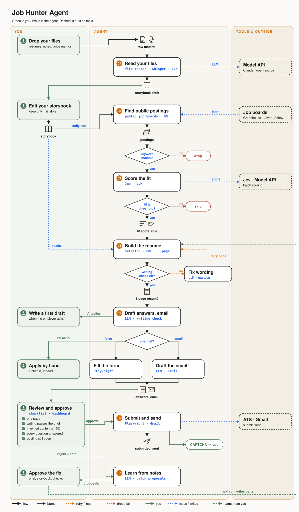

<p align="center"></p>

# Job Hunting Agent

A personal agent that turns your own material into job applications: it finds postings, ranks them, writes a
one-page résumé from facts you approved, fills the form or drafts the email, and waits for you to say yes.

**New here? Start with the [User guide](USER_GUIDE.md).**



## The seven steps

| # | Step | Module | What happens |
|---|---|---|---|
| 01 | Intake | `agent/intake.py` | Old résumés, notes and transcripts in `inbox/` become a storybook draft. You review it; nothing is merged for you. |
| 02 | Discover | `agent/sources/` | Company job boards (Greenhouse, Lever, Ashby), Hacker News "Who is hiring". More sources in `docs/03-job-sources-and-apis.md`. |
| 03 | Rank | `agent/jev.py`, `agent/llm.py` | Jev (TypeSafe) rates every posting in batches; a model then reviews the best ones and picks the role lens. A keyword ranker covers the case with no key. |
| 04 | Compose | `agent/assemble.py`, `agent/resume/` | Picks storybook lines tagged for the role, orders them, renders a one-page PDF with embedded links. Works with no model call; a model can tailor on top. |
| 05 | Write | `agent/llm.py`, `agent/cover.py` | Form answers, emails, cover letter, why-this-company. Cover-letter prompts are a first version. |
| 06 | Review | `agent/audit.py`, `dashboard/` | A checklist per application (one page, writing checks, invented content under the cap, all questions answered, posting still open). Approve unlocks only when it passes. |
| 07 | Apply | `agent/apply/`, `agent/run.py` | Refills the form in a visible browser and submits, or hands an approved email to the sender. CAPTCHAs, LinkedIn and Indeed stay with you. |

Every step writes to an activity log you can read in the dashboard.

## Writing rules

`docs/00-house-rules.md` is a one-page brief every model call reads: be true to the storybook, use the field's own
vocabulary, sound like the person. Mechanical rules live in code instead of prompts: plain job-title headlines
(`agent/headline.py`), links as words (`agent/links.py`), writing checks (`agent/voicecheck.py`), one page (`agent/resume/render.py`).

## Run it

```bash
pip install -r requirements.txt
python -m playwright install chromium
cp .env.example .env
cp -r profile.example profile          # then write your own storybook in profile/master
python -m agent.run daily              # discover, rank, compose, write, fill forms (never submits)
python -m dashboard.app                # http://127.0.0.1:8765
python -m agent.run submit             # submit what you approved, in a visible browser
```

Several stories at once: keep one storybook per story under `profiles/` and pick it with `JHA_PROFILE=profiles/<story>`.
Voice notes in `inbox/` are transcribed locally if `faster-whisper` is installed.

Other commands: `intake`, `discover`, `score`, `tailor <job_id>`, `cover <job_id>`, `prepare`, `outbox`, `status`.

## Models

Set `LLM_PROVIDER` in `.env`:

| Provider | Use it for | Settings |
|---|---|---|
| `anthropic` | Claude through the API | `ANTHROPIC_API_KEY` |
| `openai_compat` | Open-source models on Ollama, vLLM, LM Studio, llama.cpp, or OpenRouter | `LLM_BASE_URL`, `LLM_MODEL`, `LLM_API_KEY` |
| `claude_code` | Your local Claude Code login, no API key | `claude` on PATH |

Every node calls one function, `structured(system, prompt, Schema)` in `agent/providers.py`, so adding a provider
means adding one function there. Ranking uses `TYPESAFE_API_KEY` when present.

## Your data

`profile/` (storybook, preferences, contact details), `data/`, `out/` and `inbox/` are git-ignored. The repo ships
`profile.example/` with a fictional person so you can see the format.

## Status

Working: discovery from company boards and Hacker News, ranking, résumé composition, form filling on Ashby and
Greenhouse, email drafting, review dashboard, activity log, daily scheduled run.
Not yet: aggregator and social-media sources, the proposal finder for companies that published a problem,
tuned cover-letter prompts, dropdown fields on Greenhouse forms.

## License

MIT
